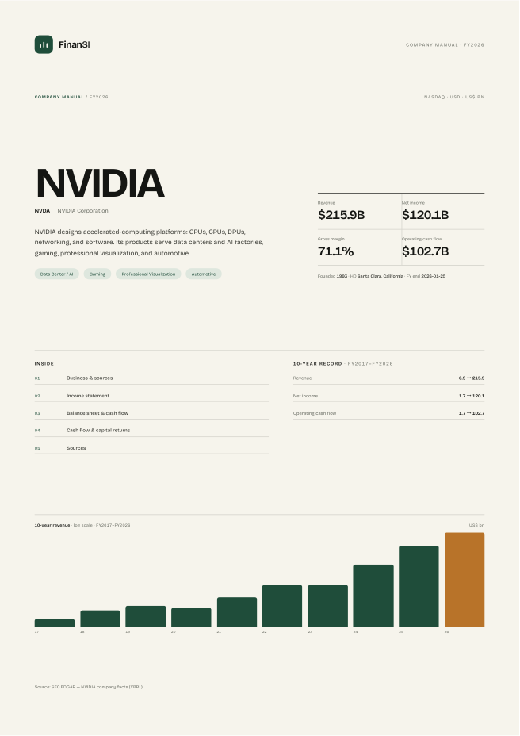
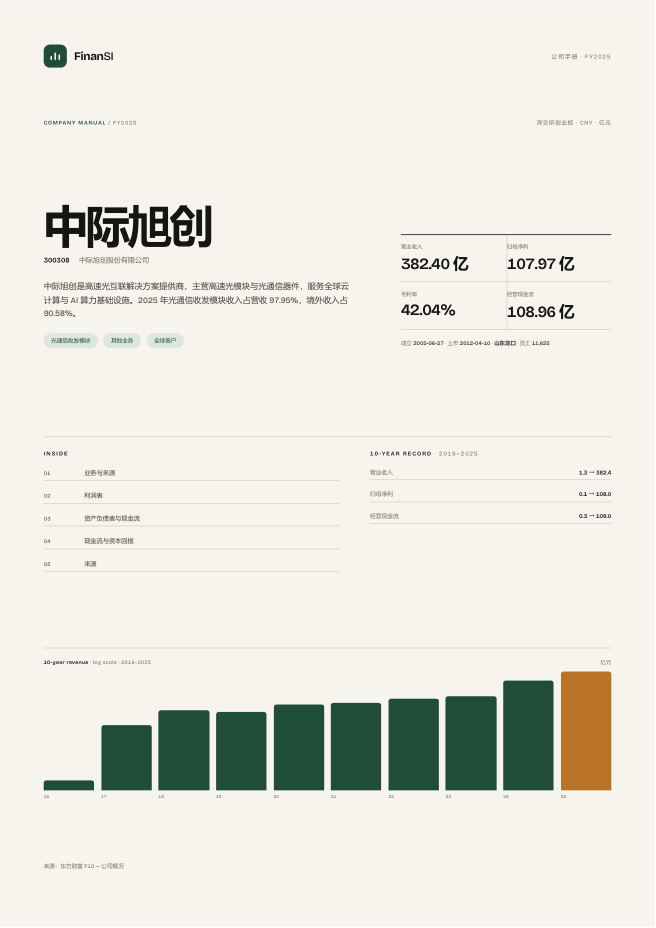

# 公司手册

**公司手册**：一句话把一家上市公司变成一份可打印、可追溯的事实手册——十年财务、业务结构、现金流、资本配置和来源。

[](https://github.com/LINZIQI24GITHUB/finansi-company-manual/actions/workflows/ci.yml)
[](https://www.python.org/)
[](LICENSE)
[](#data-rules)

**One command turns a listed company into a printable company manual.**
Ten years of reported financials, the business mix, cash flow, and sources — on the page, not in a chat window.
Currently ships NVIDIA (FY2026 10-K), Apple (FY2026 10-K), Tesla (FY2025 10-K), 中际旭创 (2025 annual report), 宁德时代 (2025 annual report), 贵州茅台 (2025 annual report) and 中国平安 (2025 annual report). Any other company needs its own `data/<code>/company.json`.

```bash
git clone https://github.com/LINZIQI24GITHUB/finansi-company-manual.git
cd company-manual
python bin/manual.py --company nvda --open
```

Output: `out/manual-nvda.html`. Click **Print / Save PDF**, print A4.

**No API key, no package install** — Python 3.11+ and the standard library. The renderer makes no network calls; the data ships as JSON files.

**See the output before you run it:** [NVIDIA, 4 pages (PDF)](examples/manual-nvda.pdf) · [Apple, 4 pages (PDF)](examples/manual-aapl.pdf) · [Tesla, 4 pages (PDF)](examples/manual-tsla.pdf) · [中际旭创, 4 pages (PDF)](examples/manual-zjxc.pdf) · [宁德时代, 4 pages (PDF)](examples/manual-catl.pdf) · [贵州茅台, 4 pages (PDF)](examples/manual-moutai.pdf) · [中国平安, 4 pages (PDF)](examples/manual-pingan.pdf)





> **This is FinanSI's open-source flagship, not the full catalog.** Other FinanSI skills are commercial and are not published in this repository.
> Full catalog: **https://finansi.work/?utm_source=github&utm_medium=readme&utm_campaign=company_manual**

## Use it as an agent skill

Any agent that reads `SKILL.md` can install it. Paste this into Claude Code, Codex, or Cursor:

```text
Read https://finansi.work/skills/company-manual/install.md?utm_source=github&utm_medium=readme&utm_campaign=company_manual
and follow the instructions to install the company-manual skill.
Then make a company manual for NVIDIA from its FY2026 10-K.
```

The install doc picks the right skills directory for your agent (`~/.claude/skills/`, `~/.codex/skills/`, `~/.agents/skills/`, …) and ends with one real task to verify the install.

## What is inside

| Section | Content |
| --- | --- |
| Cover | identity, business, key facts, 10-year record, revenue strip |
| Business | description, pillars, segment mix when disclosed, company facts, data notes |
| Income | revenue / net-margin chart, 10-year table, observations, YoY growth |
| Balance & cash | 10-year balance sheet and cash flow, cash conversion, FCF, five-year cash table, assets/equity chart |
| Capital allocation | only if dividends or buybacks exist |
| Sources | sources, method, definitions |

Conditional sections are omitted when the data is not there. No empty sections, no estimates, no padding to hit a page target.

Page count follows what the company actually discloses, not a template. The current demos fit in 4 pages each; that is a layout result, not a specification. A company with fewer years or no segment data will be shorter; a group with segments, buybacks, and governance history will be longer.

## Current demos

| Company | Period | Currency | Latest annual |
| --- | --- | --- | --- |
| NVIDIA | FY2017–FY2026 | US$ bn | FY2026 10-K, ended 2026-01-25 |
| Apple | FY2017–FY2026 | US$ bn | FY2026 10-K, ended 2026-09-26 |
| Tesla | FY2016–FY2025 | US$ bn | FY2025 10-K, ended 2025-12-31 |
| 中际旭创 | 2016–2025 | 亿元 | 2025 annual report |
| 宁德时代 | 2016–2025 | 亿元 | 2025 annual report |
| 贵州茅台 | 2016–2025 | 亿元 | 2025 annual report |
| 中国平安 | 2016–2025 | 亿元 | 2025 annual report |

## Why this exists

Most “AI finance” output is a chat answer or a Markdown report. This project treats the deliverable as a **company manual**:

- a standardized entry for every company;
- 10-year reported financials;
- business mix and capital allocation when disclosed;
- sources and definitions on the page;
- variable length, because companies are not equally complicated.

The design reference is the page-by-page company manual tradition (Moody's / Value Line style). This project is not affiliated with either.

## Which company next?

Open a [Discussion](https://github.com/LINZIQI24GITHUB/finansi-company-manual/discussions) with a ticker and the one page you actually need. Next demo is picked from there, not from a roadmap.

## Repository layout

```text
company-manual/
├─ bin/manual.py              # CLI: one company or --all
├─ templates/
│  ├─ manual.css              # paper, type, tables, panels
│  └─ manual-flow.css         # continuous page flow
├─ schema/company.schema.json # data contract
├─ data/
│  ├─ nvda/company.json
│  ├─ aapl/company.json
│  ├─ tsla/company.json
│  ├─ catl/company.json
│  ├─ moutai/company.json
│  ├─ pingan/company.json
│  └─ zjxc/company.json
├─ assets/                    # cover previews, embedded font
├─ examples/                  # sample PDFs
├─ tests/                     # stdlib unittest
└─ .github/workflows/         # CI
```

## Add a company

1. Create `data/<slug>/company.json` following `schema/company.schema.json`.
2. Keep all money values in one currency and one unit; the renderer does not convert.
3. Use reported figures only. If a field is missing, use `null`; do not estimate.
4. Run:

```bash
python bin/manual.py --company <slug> --open
```

## Data rules

- Use annual reports, SEC XBRL, or another named public source.
- Every entry must list sources with URLs.
- Margins and FCF are computed from reported line items and labelled as computed.
- Flag accounting-scope changes (acquisitions, restatements) in `notes`.
- No adjusted, forecast, or vendor-estimated numbers.
- No ratings, scores, target prices, or trade recommendations.
- Data remains subject to the terms of its original source.

## Development

```bash
python -m unittest discover -s tests -v
python bin/manual.py --all --out out
```

No third-party dependencies for rendering. PDF export is done by the browser print dialog. CI renders both HTML files and uploads them as an artifact.

See [CONTRIBUTING.md](CONTRIBUTING.md) for the PR checklist.

## License

Code and templates: MIT. Data and third-party content: original terms.
